# VIC-ENP: the VIC recruitment landing page

The public landing page for the 2026 recruitment of the **Vision & Innovation Club (VIC)**, a student club at the
École Nationale Polytechnique (ENP) in Algiers. It is a scroll-driven 3D page that introduces the club (its
departments, events and projects, and what a season in it looks like) to ENP students, first-years above all, and
ends on one call to action: **Apply**.

Live at **https://www.vic-enp.com**.

<p align="center">
  
</p>

## What it does

- **The landing page (`/`).** One English page, built for a phone opened from an Instagram or WhatsApp link. A
  single WebGL canvas behind the page draws a field of points that forms the VIC icon, the club's photos and each
  section's scene as the visitor scrolls. Every word on the page is real HTML: the canvas is decoration only, and
  the page reads in full without WebGL, without JavaScript's 3D chunk, or with reduced motion.
- **A timed call to action.** Before applications open, the Apply button shows a countdown and points to the
  club's Instagram. At the opening time it switches on its own to the registration link, and at the closing time
  (`src/calendar.ts`) back to Instagram, reading "Applications closed".
- **The registration form (`/apply` and `api/`).** A short form for ENP students. A candidate proves their ENP
  address with a one-time code sent by email, then submits; the answers are written to the club's recruitment
  sheet. The landing page itself collects nothing.

## The page, act by act

<p align="center">
  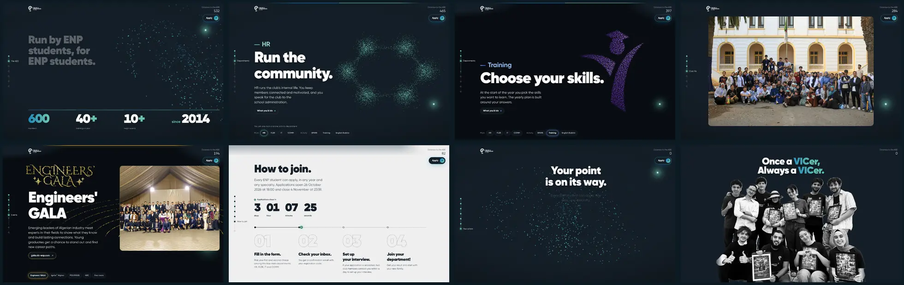
</p>

Each department draws its own formation as it scrolls in, out of the same 600 points:

<p align="center">
  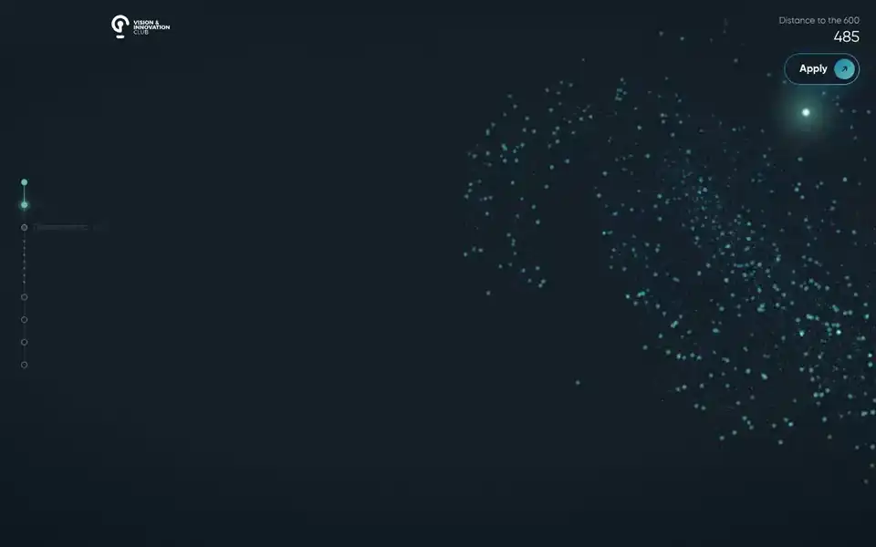
</p>

| | |
|---|---|
| 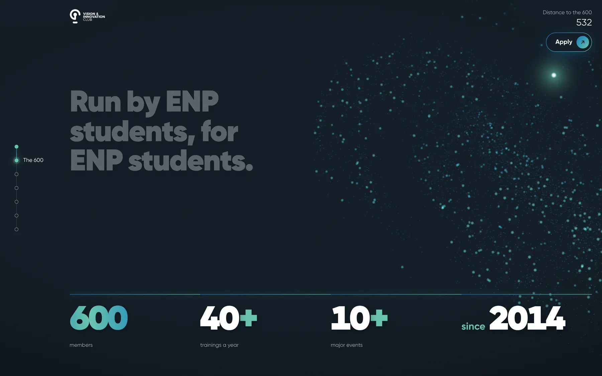 | 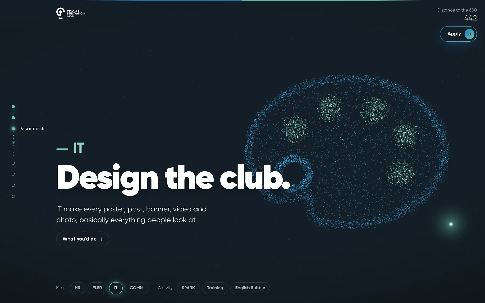 |
| 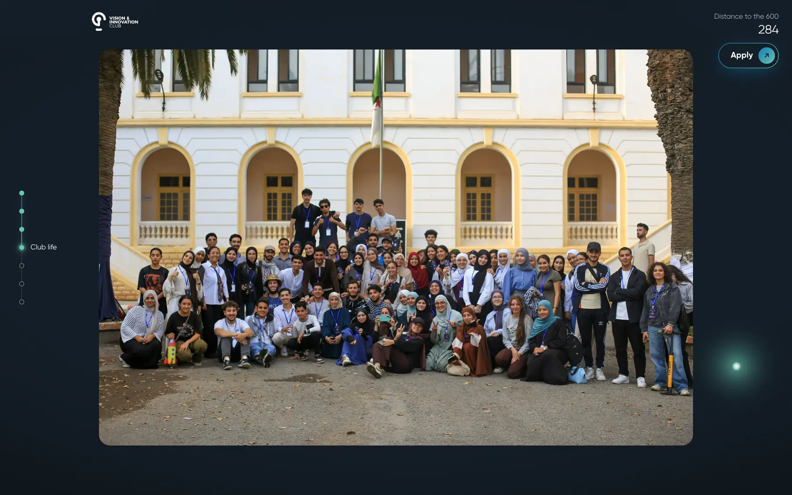 | 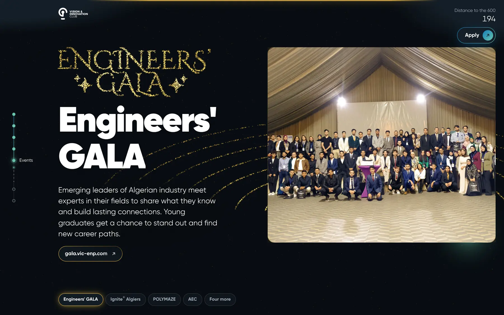 |
| 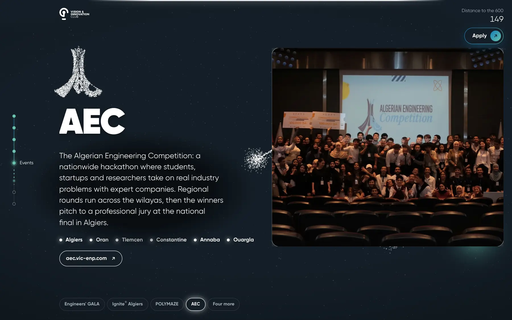 | 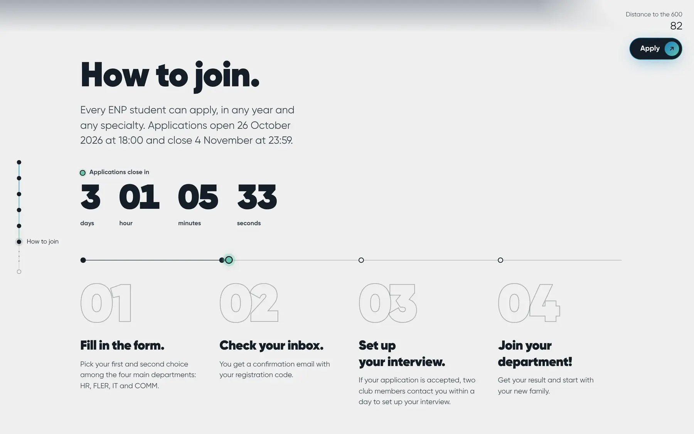 |
| 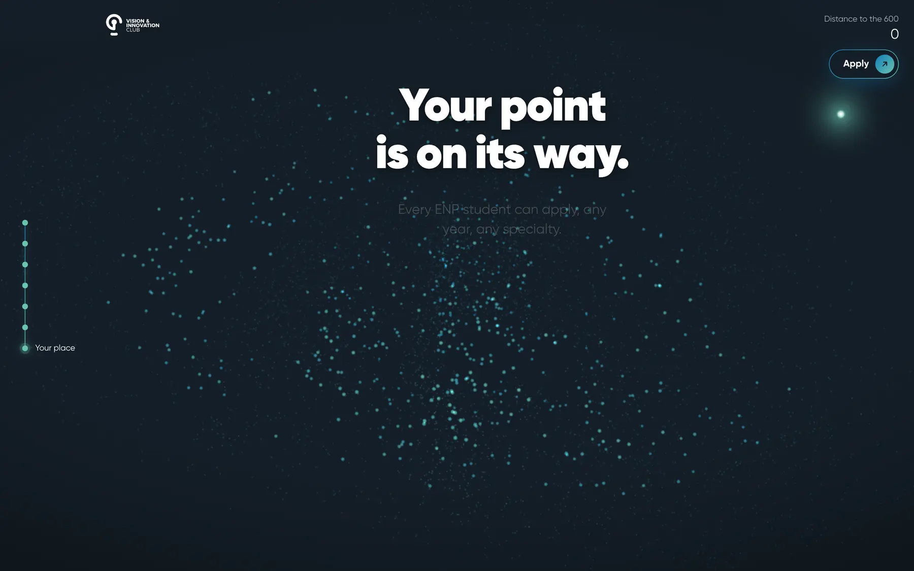 | 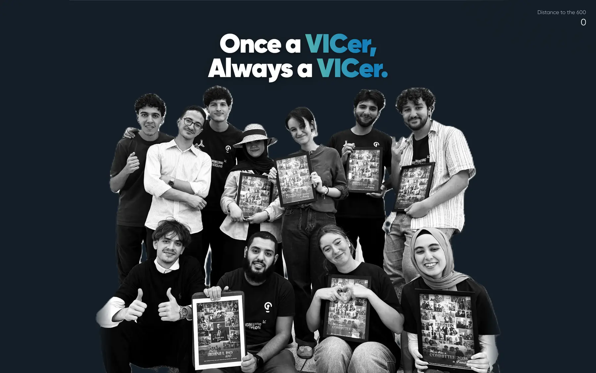 |

### On a phone

The page is built for a phone opened from an Instagram or WhatsApp link, with its own compositions and momentum.

<p align="center">
  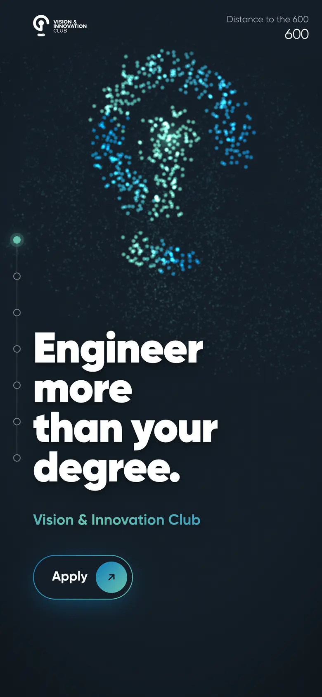
  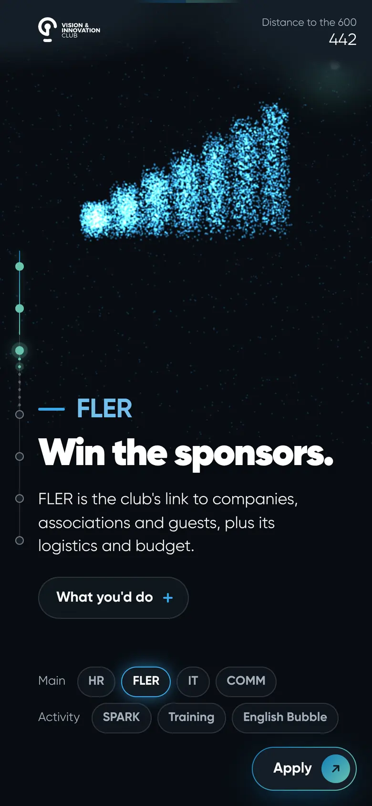
  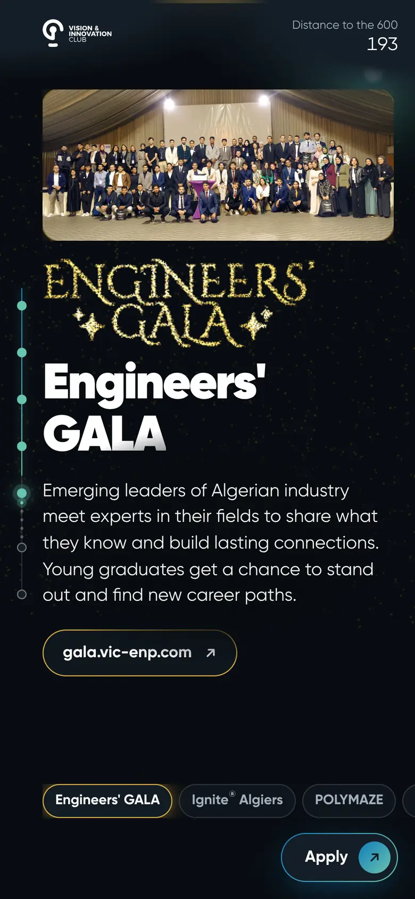
  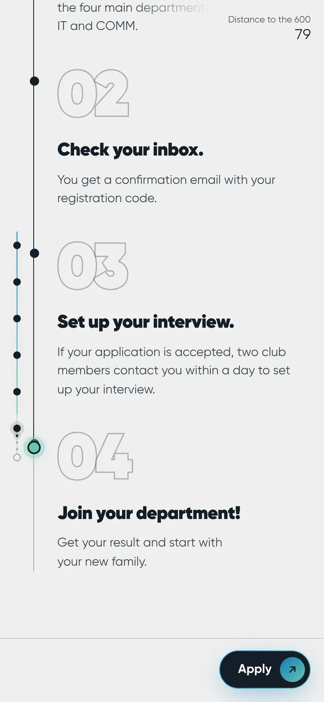
  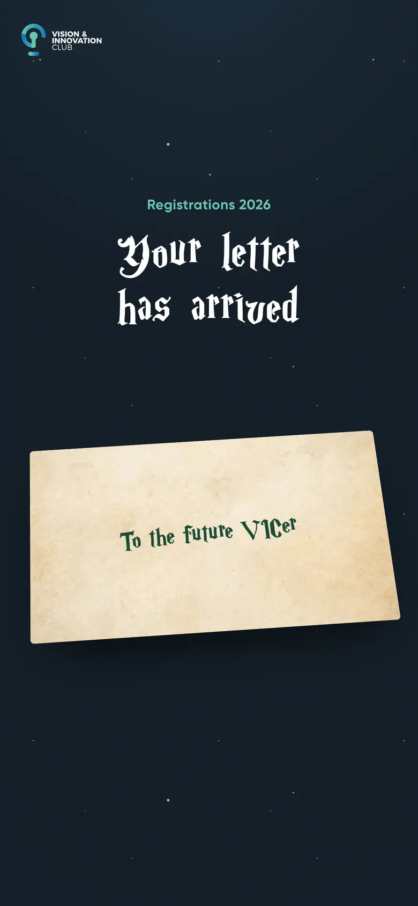
</p>

### `/apply`

A letter for the future VICer. On a first visit the envelope turns under the scroll, its wax seal breaks, and the
letter unfolds onto the first stop, Platform 9¾.

<p align="center">
  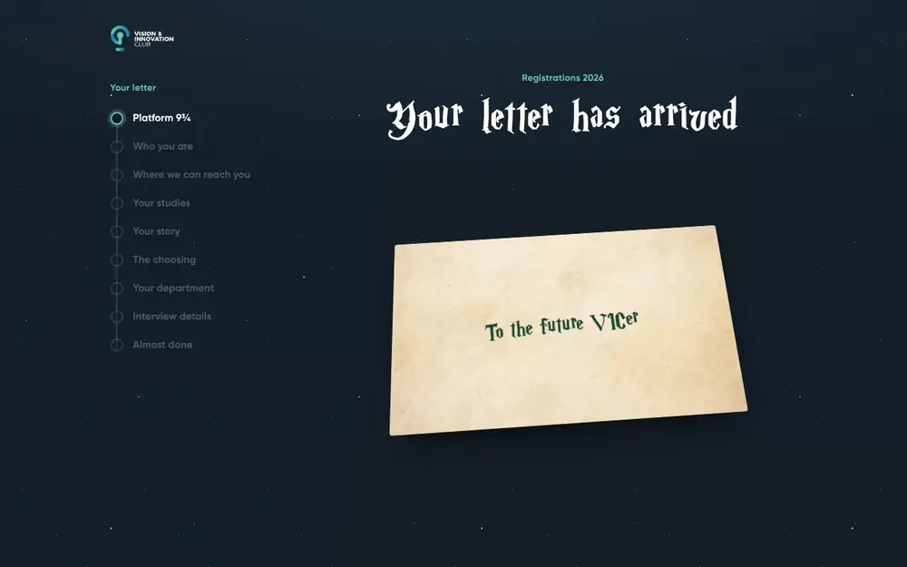
</p>

| | |
|---|---|
| 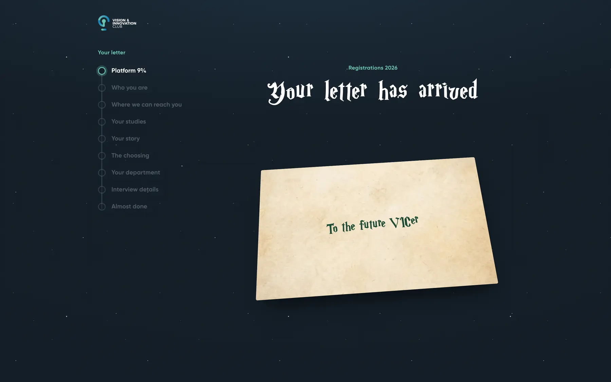 | 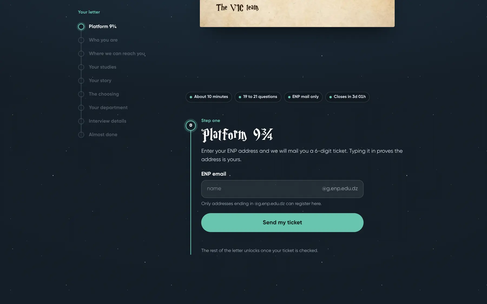 |

The recruitment team's side of things (routing candidates to interviewers, alerts, the dashboard) lives in
[vic-recruitment](https://github.com/puIad/vic-recruitment).

## Stack

| Piece | Choice |
|---|---|
| Build | Vite, TypeScript |
| UI | React 19, Tailwind CSS v4 |
| 3D | three.js through React Three Fiber and drei |
| Scroll | Lenis (smooth scroll) and GSAP ScrollTrigger |
| Images | a `sharp` script that turns photo originals into AVIF and WebP sizes |
| Registration API | Vercel functions in `api/`, Upstash Redis, the Google Sheets API, an Apps Script mailer |
| Tests | Vitest |
| Hosting | Vercel |

## Run it locally

You need Node.js 22 or newer.

```bash
npm install
npm run dev       # the page on http://localhost:5173
npm test          # unit tests (the API runs against in-memory fakes, no accounts needed)
npm run build     # type-check and build to dist/
```

Useful while developing:

- Add `?now=<ISO date>` to any URL to see the page at another moment, in UTC (a `+` in a URL reads as a space), for
  example `http://localhost:5173/?now=2026-10-27T09:00:00Z` shows the Apply button after opening.
- The registration link comes from the `VITE_APPLY_URL` environment variable at build time. Without it the page
  still runs, and the button falls back to the club's Instagram after opening.
- The `/apply` form's API needs its own environment variables (Redis, a Google service account, the mailer), listed
  in `api/_lib/env.ts`. They are set in the Vercel project and are not part of this repository.

## Project layout

```
index.html            the page shell: meta tags, share image, first-paint text
apply.html            the registration form's entry
src/
  sections/           one component per section of the page, plain DOM
  content/            the page's text and data (departments, events, FAQ, photo captions)
  world/              the 3D canvas: point formations, shaders, device tiers
  scroll/             Lenis and ScrollTrigger, mapping scroll progress into the 3D world
  apply/              the registration form's UI
  config.ts           the opening time, the registration link, social links
api/                  the registration form's Vercel functions
public/               logos, resized photos, share image
scripts/              the photo and logo pipelines, load tests
docs/                 the full plan: brief, content, experience, architecture, decisions
```

The design and build decisions are written up in [`docs/`](docs/README.md), starting with
[`docs/brief.md`](docs/brief.md) and [`docs/architecture.md`](docs/architecture.md).

## Fonts and brand assets

- **Gilroy**, the club's typeface, is a commercial font. The files in `src/assets/fonts/` are the club's own copies
  and are not licensed for reuse or redistribution. If you fork this project, replace them with a
  font you have the rights to and update `src/fonts.css` (the build's font preload in `vite.config.ts` looks for
  the Gilroy file names).
- The VIC name, logo, icon, photos and event logos belong to the Vision & Innovation Club and are not open for
  reuse.
- The registration form's other font, Cormorant Garamond, comes from Fontsource under the SIL Open Font License.

## Contributing

This page is built and maintained by VIC's IT department for the club's own recruitment. Issues are welcome; for
anything else, reach the club at vic@g.enp.edu.dz or on Instagram at
[@vic.enp](https://www.instagram.com/vic.enp/).

No open-source licence has been chosen for this repository, so the code is all rights reserved unless a licence
file is added later.
